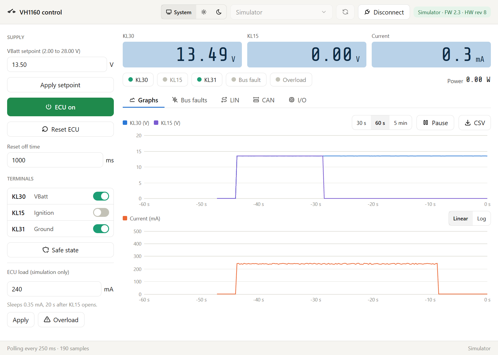
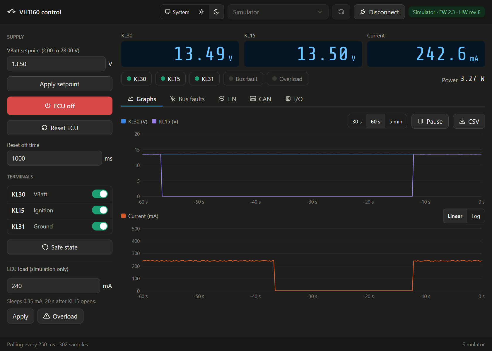

# VH1160 control

Rust tools for the Vector VH1160 / VH1150 ECU test box over USB. The box appears as an FTDI COM port (230400 8N1) and speaks a small ASCII protocol: one command letter, optional digits, then CR.

Vector's `VHDevDLL.dll` only works inside CANoe, so the protocol was read out of that DLL (CANoe 17, v2.9.0.0). The command table is in `crates/vh1160-core/src/protocol.rs`.

- `crates/vh1160-core`: protocol library and a built-in simulator
- `crates/vh1160-cli`: the `vh1160-cli` command-line tool
- `app/`: the `vh1160` GPUI desktop app (gpui-pre) with live voltage and current graphs





## CLI

```bash
cargo run -p vh1160-cli -- ports
```

```bash
cargo run -p vh1160-cli -- info
```

Other commands: `read [--json]`, `monitor [--interval 250ms] [--csv out.csv]`, `vbatt 13.5`, `relay 30 on`, `on [13.5]`, `off`, `reset [--off 1s]`, `safe`, `reset-overload`, `fault --interrupt h --short-l gnd`, `fault clear`, `fault periodic gnd --hz 1000`, `lin ground-offset 2.0`, `lin cab internal`, `can termination`, `can diff`, `can caps on`, `io aout 5.0`, `io dout high`, `raw t 6`.
`--port COM7` picks a port (otherwise it's auto-detected by sending the version request to every FTDI port) and `--sim` uses the simulator. Each `--sim` call starts a fresh simulator.

## Desktop app

```bash
cargo run -p vh1160-app
```

Pick a COM port or "Simulator", then Connect. The simulator models an ECU that draws its load current while KL15 is on and sleeps 20 s after KL15 opens, a 120 Ω CAN termination, and loops the analog/digital outputs back to the inputs. The theme, last port, VBatt setpoint and reset off time are kept in `%APPDATA%\vh1160\settings.json`.

The box cannot report its relay states, so the switches show what was last sent; right after connecting they are guessed from the measured KL30/KL15 voltages.

## Building a release

```bash
cargo build --release -p vh1160-app -p vh1160-cli
```

The output is `target/release/vh1160.exe` (the app) and `target/release/vh1160-cli.exe` (the CLI). A release build of the app compiles GPUI's shaders with `fxc.exe` from the Windows SDK; set `GPUI_FXC_PATH` if it is not found.

## Assets

`app/assets` holds Tabler icons as SVG (MIT, `app/assets/icons/LICENSE`) and Share Tech Mono as TTF (SIL OFL 1.1, `app/assets/fonts/OFL.txt`).

The app icon is `app/assets/icon/vh1160.svg`, with `vh1160-small.svg` (thicker strokes) used for 24 px and below. Both exes embed `vh1160.ico` through their build.rs. After editing the SVGs, regenerate the .ico:

```bash
uv run tools/make_icon.py
```

## Tests

```bash
cargo test --workspace
```

## License

MIT, see `LICENSE`. The bundled icons and font keep their own licences (see Assets).
